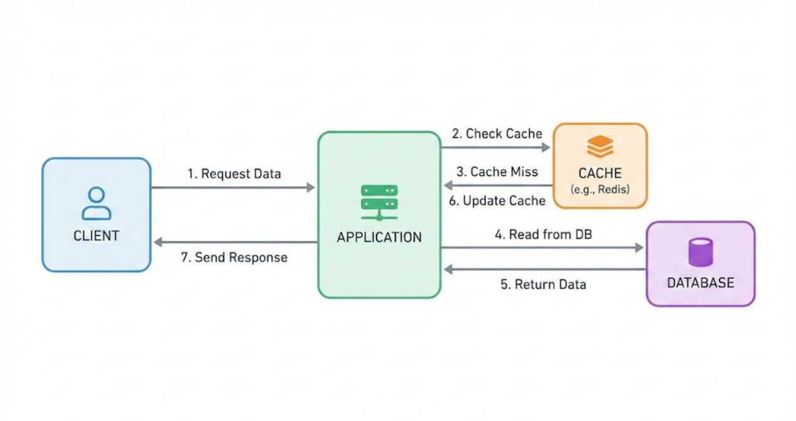
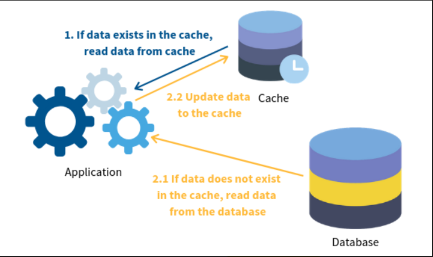
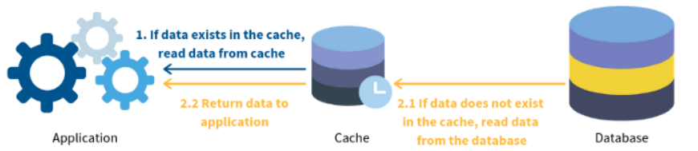
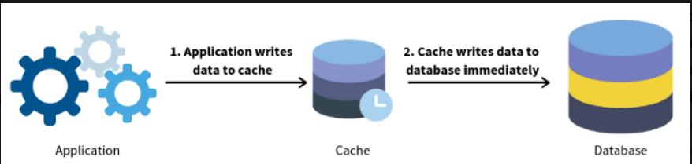
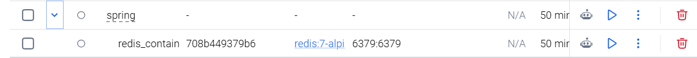
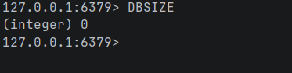
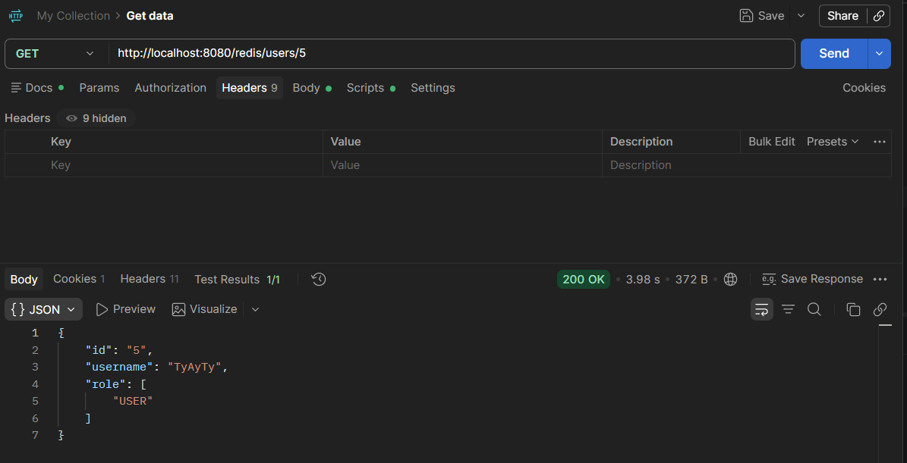
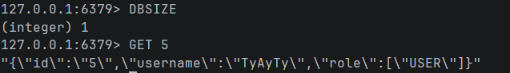
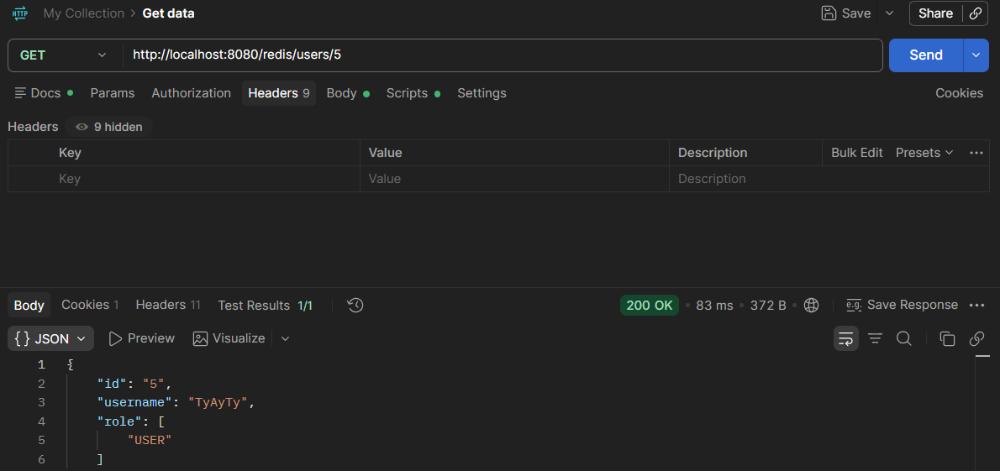

# Caching

## Caching là gì? Tại sao cần?
### Caching là gì?
Caching là một kỹ thuật tăng tốc độ truy xuất dữ liệu và giảm tải cho hệ thống. Cache là nơi lưu tập hợp các dữ liệu, thường có tính chất nhất thời, cho phép sử dụng lại dữ liệu đã lấy hoặc tính toán trước đó, nên sẽ giúp tăng tốc cho việc truy xuất dữ liệu ở những lần sau.
### Caching hoạt động như thế nào?
Dữ liệu trong cache (bộ đệm) thường được lưu trữ trong RAM (Random-access memory). Mục đích chính của cache là tăng hiệu suất truy xuất dữ liệu. Cache thường lưu trữ một tập hợp con dữ liệu tạm thời.


### Tại sao cần dùng cache?

- Tăng tốc độ: Lấy dữ liệu từ cache sẽ nhanh hơn truy vấn dữ liệu từ database.
- Giảm tải database: Giảm số lượng các câu truy vấn đến MySQL.
- Tăng khả năng chịu tải: Hệ thống có thể phục vụ nhiều request hơn.
- Tăng trải nghiệm của người dùng: Do tăng được tốc độ truy vấn -> Người dùng sẽ nhận được kết quả nhanh hơn.

## Cache ở đâu? Application-level vs Distributed cache

### Cache ở đâu?
Cache có thể được đặt ở nhiều vị trí khác nhau trong hệ thông: Broweser Cache, CDN Cache, Application Cache...

### Application-level là gì?

Application-level cache là cache nằm trực tiếp trong bộ nhớ của dứng dụng, nó có đặc điểm:
- Truy xuất nhanh vì dữ liệu nằm ngay trong RAM của ứng dụng.
- Cấu hình và triển khai đơn giản.
- Không cần triển khai của 1 máy chủ cache riêng.
- Mỗi instance ứng dụng có một vùng cache độc lập.
- Khi ứng dụng restart, dữ lệu cache thường bị mất
- Hạn chế khi có nhiều instance
VD: 1 hệ thống có 2 instace, Spring boot 1 và Sping boot 2 tương ứng là 2 cache: cache 1, cache 2. Khi Spring boot 1 lưu thông tin của sản phẩm có id = 8 vào cache 1 nhưng khi request được chuyển sang Spring boot 2 thì sẽ không có dữ liệu trong cache 2 và phải truy vấn đên database.

### Distributed Cache là gì?

Distributed Cache( Cache phân tán) là hệ thống cache được triển khai riêng biệt, cho phép nhiều ứng dụng học nhiều instace cùng truy cập. Nó có đặc điểm
- Nhiều instance có thể sự dụng chung 1 vùng cache
- Dữ liệu không phụ thuộc vào bộ nhớ của 1 instance ứng dụng
- Phức tạp hơn trong việc câu hình và triển khai
- Phải tính đến độ trễ của mạng.
VD: Khi này, nếu Spring boot 1 lấy thông tin sản phẩm id = 8 từ redis. Thì sau đó, Spring 2 cũng có thể lấy chính dữ liệu đó từ redis.

### So sánh Application-level Cache vs Distributed Cache

| Tiêu chí | Application-level Cache | Distributed Cache |
|---|---|---|
| Vị trí | RAM của ứng dụng | Máy chủ riêng |
| Ví dụ | Caffeine | Redis |
| Tốc độ | Thường nhanh hơn | Có thêm độ trễ mạng |
| Chia sẻ dữ liệu | Không tự chia sẻ | Nhiều instance dùng chung |
| Triển khai | Đơn giản | Phức tạp hơn |
| Khi restart app | Cache thường mất | Cache có thể vẫn tồn tại |
| Phù hợp | Ứng dụng nhỏ, một instance | Hệ thống nhiều instance |

## Khi nào nên dùng cache, khi nào không nên cache

- Nên dùng cache khi dữ liệu được nhiều người truy câp, truy cập nhiêu lần, thường xuyên đọc, ít thay đổi.
- Không nên cache khi dữ liệu ít khi được truy cập, thay đổi liên tục.

# Chiến lược Caching

## Cache-Aside

Cache-Aside là chiến lược trong đó ứng dụng tự quản lý việc đọc và ghi cache. Vùng nhớ cache thường đặt một bên, application sẽ giao tiếp trực tiếp với cache và database.

Cách hoạt động:
1. Application sẽ kiểm tra trong cache có dữ liệu mình cần hay không, nếu trong cache có dữ liệu application cần, quá trình sẽ kết thúc. Nếu cache không có dữ liệu, chúng ta sẽ tới bước 2.
2. Khi cache không chứa dữ liệu mà application cần, application sẽ xuống database để lấy dữ liệu.
3. Application sẽ lưu dữ liệu lấy được từ database để lưu vào cache, sau đó nó làm tiếp công việc của mình.

| Ưu điểm | Nhược điểm |
|---|---|
| Giảm tải cho Database. | Cache Miss có thể làm tăng thời gian phản hồi. |
| Tăng tốc độ truy xuất dữ liệu. | Có nguy cơ dữ liệu Cache không đồng nhất với Database. |
| Chỉ Cache dữ liệu thực sự được sử dụng (Lazy Loading). | Có thể xảy ra Cache Stampede. |
| Dễ triển khai và kiểm soát quá trình Cache. | Phải tự quản lý việc cập nhật và xóa Cache. |
| Database vẫn là nguồn dữ liệu chính. | Cache có thể không chứa đầy đủ dữ liệu cần thiết. |
| Không cần nạp toàn bộ Database vào Cache từ đầu. | Hiệu quả phụ thuộc vào tần suất đọc và tỷ lệ Cache Hit. |

Cache Stampede là hiện tượng khi một dữ liệu hết hạn hoặc bị xóa, khiên nhiều request không tìm thấy dữ liệu trong cache dẫn đến phải truy cập vào database, khiên cho database bị quá tái, thậm chí làm hệ thống bị chậm hoặc ngừng hoạt động.

## Read through cache

Read through cache khá giống với Cache aside nhưng thay vì application phải kết nối với cache và database thì giờ đây application chỉ cần giao tiếp với cache. Còn cache sẽ tự lấy dữ liệu ở chính nó hoặc xuống database lấy dữ liệu.

Cách hoạt đông: 
1. Application sẽ gửi request tới cache để lấy dữ liệu.
2. Nếu cache có dữ liệu, nó sẽ trả dữ liệu cho application. Nếu cache không có dữ liệu thì xuống bước 3
3. Nếu cache không chứa dữ liệu mà application cần thì cache server sẽ tự động lấy dữ liệu từ database để update cho bản thân mình và trả về cho application.
4. Trả dữ liệu cho application.

## Write through cache

Write through cache chiến lược này data sẽ được lưu xuông cache, cache sẽ lưu dữ liệu vào database.

Khi 1 request write tới: 
1. Dữ liệu sẽ được lưu vào cache.
2. Cache sẽ gửi yêu cầu lưu dữ liệu vào database ngay lập tực.

### Lợi ích.
- Không xảy ra trường hợp cache miss, bởi vì dữ liệu luôn được lưu vào cache trước khi lưu vào database.
- Không xảy ra trường hợp dữ liệu không hớp với database.
- Dữ liệu sẽ luôn đồng nhất nếu ta kết hợp Write through cache và read through cache

### Nhược điểm
- Hầu hết các dữ liệu trên cache đều là dữ liệu đọc một lần, vậy nên việc ghi qua cache sẽ dẫn tới rất nhiều dữ liệu tồn tại trên cache không cần thiết.
- Dữ liệu ở cache nganh ngửa database, dẫn đến có các bản ghi không cần thiết.

### Khi nào nên sử dụng Cache aside, khi nào nên sử dụng Write though cache?
- Cache aside thường được dùng trong trường hợp read-heavy workloads(thoa tác đọc dữ liệu xảy ra nhiều hơn so với thao tác ghi dữ liêu). Khi chúng ta thấy dữ liệu sử dụng nhiều, dữ liệu lặp lại... thì nên dùng cache aside. 
- Write through cache thường được dùng trong trường hợp write-heavy workloads( thao tác ghi dữ liệu xảy ra nhiều hơn so với thao tác đọc dữ liệu).

# Redis

## Redis là gì?

Redis là một in-memory remote database cung cấp hiệu xuất cao, mã nguồn mở. Redis được viết tắt từ Remote Dictionary Server, là một kiểu non-relational databbase tốc độ cao dùng để chứa dữ liệu dạng key-values của các kiểu dữ liệu khác nhau. Ngoài ra Redis còn hỗ trợ các tính năng khác như in-memory persistent storage on disk , replication để tăng hiệu xuất đọc dữ liệu và client-side sharding để tăng hiệu xuất ghi.

## Các kiểu dữ liệu và các câu lênh cơ bản trong Redis?

### String
Kiểu dữ liệu String trong Redis có thể là chuỗi, số, dữ liệu nhị phân..Các câu lệnh cơ bản đổi với kiểu dữ liệu String:
- GET: Lấy ra giá trị value của key
- SET: Thiết lập giá trị cho key
- DEL: Xóa key-value

### List

Việc lưu trữ một danh sách theo thứ tự của các String (trước, sau) trong Redis là linked list. Ưu điểm của nó là việc add thêm 1 phần từ vào đầu hoặc cuối của List khá là dễ dàng mà không quan tâm đến kích thước của list. Tuy nhiên, cách làm này thì việc tìm kiếm phần tử theo index lại khó khăn hơn. Các câu lệnh cơ bản đối với List:
- LPUSH/RPUSH: Push dữ liệu vào đầu/cuối của LIST.
- LRANGE: Lấy ra 1 dải giá trị của LIST.
- LINDEX: Lấy ra index của phần tử.
- LPOP/RPOP: Xóa dữ liệu ở đầu và cuối LIST.

### SET

Sự khác nhau giữa SET và LIST là thứ tự của các phần tử trong SET không được sắp xếp theo trước sau như LIST, mà là bất quy tắc. Các phần tử của SET thì được lưu trữ dưới dạng hash table (bảng băm) để tăng performance. Nói cách khác là mỗi phần tử này sẽ là 1 key trong hash table và không có value => tăng tốc độ truy xuất dữ liệu mà không bị trùng lặp phần tử. Các câu lệnh cơ bản đối với Set:
- SADD: Thêm một phần tử vào Set.
- SMEMBERS: Lấy ra tất cả phần tử của Set.
- SISMEMBER: Check xem 1 phần tử có tồn tại trong Set không.
- SREM: Xóa đi 1 phần tử của Set(nếu nó tồn tại).

### HASH

HASH lưu trữ các tập các map của key-value với Key: String và value: String hoặc số. Các câu lệnh cơ bản của Hash:
- HSET: Thêm 1 cập key - value vào hash hoặc thay đổi gia trị của key đã có.
- HGET: Lấy giá trị của key trong hash có sẵn.
- HGETALL: Lấy tất cả phần tử của Hash.
- HDEL: Xóa cập key - value ra khỏi Hash.

### SORTED SET 
Sorted Set là phiên bản đầy đủ hơn của Set, khi này Sorted Set lưu 1 cập member - score ( score là float menber), các cặp menber - score được add vào Set sẽ sắp xếp theo thứ tự của score, sẽ không có 2 menber trùng nhau. Các câu lệnh cơ bản Sorted Set:
- ZADD: Thêm 1 phần từ vào tập hợp với score của nó.
- ZRANGE: Lấy ra các phần tử của tập hợp theo vị trị của chúng trong Sorted Set.
- ZRANGEBYSCORE: Lấy các phần tử của tập hợp theo phạm vi của sroce
- ZREM: Xóa đi 1 phân tử của tập hợp( nếu có tồn tại).

### Bổ sung các lệnh cơ bản:
- EXISTS name: Kiểm tra key có tồn tại không.
- SET otp 123456 EX 60: gán và tự hết hạn sao 60 s.
- EXPIRE name 30: Đặt thời gian sống cho Key có sẵn.
- TTL name: Xem còn bao nhiêu giây (x > 0 thời gian sống đc x giây nữa,-1: không hết hạn, -2: key không tồn tại)
- PERSIST name: Hủy thời gian hết hạn

## Cài đặt bằng docker
```docker
  redis:
    screenshots/image: redis:7-alpine
    container_name: redis_container
    ports:
      - "6379:6379"
    command: redis-server --appendonly yes
    volumes:
      - redis_data:/data
    restart: unless-stopped
```


# Thực hành

## Cầu hình redis
```java
@Configuration
public class RedisConfig {

    @Bean
    public RedisTemplate<String, Object> redisTemplate(RedisConnectionFactory connectionFactory){
        RedisTemplate<String, Object> template = new RedisTemplate<>();
        template.setConnectionFactory(connectionFactory);

        template.setKeySerializer(new StringRedisSerializer());

        template.setValueSerializer(new JacksonJsonRedisSerializer<>(Object.class));

        template.setHashKeySerializer(new StringRedisSerializer());
        template.setHashValueSerializer(new JacksonJsonRedisSerializer<>(Object.class));
        return template;
    }

    @Bean
    public StringRedisTemplate stringRedisTemplate(RedisConnectionFactory connectionFactory){
        return new StringRedisTemplate(connectionFactory);
    }
}
```
### Server
```java
    public Object findUserById(String id){

        Object cache = redisTemplate.opsForValue().get(id);
        if(cache != null){
            return cache;
        }

        List<User> list = repositoryUser.findByid(id);
        if(list.size() == 0){
            throw new AppException(USER_NOT_EXIST);
        }
        redisTemplate.opsForValue().set(id,mapperUser.toResponseUser(list.get(0)), 10, TimeUnit.MINUTES);
        return mapperUser.toResponseUser(list.get(0));
    }
```
Tìm xem có trong redis không, nếu có trả về kết quả, nếu không tìm trong database rồi update vào redis (Chiến lược cache aside)
### Kết quả
Khi Cache miss (tốc độ phản hồi: 3.98s)




Khi Cache hit (tốc độ phản hồi: 83ms)




# Các vấn đề thường gặp

## TTL để bao lâu là hợp lý?

TTL là thời gian dữ liệu tồn tại trong cache, không có con số cố định cho TTL vì TTL phụ thuộc vào loại dữ liệu và tần suất thay đổi.

Không nên để TTL quá dài hoặc quá ngắn:
- TTL quá ngắn thường xuyên hết hạn và phải truy vấn data base.
- TTL quá dài dư liệu có thể không đồng bộ.

## Cache Invalidation

Cache Invalidation là vấn đề dữ liệu trong data base được cập nhật, nhưng trong redis vẫn chứa dữ liệu cữ gây bất đồng bộ.

###  Một số các xử lý:
- Cache Aside + delete Cache:
Bước 1: cập nhật Database 

Bước 2: Xóa key tương ứng trong redis

Khi người dùng truy vấn lấy dữ liệu mới update thì cache miss -> phải truy vấn lại vào database rồi cập nhật dữ liệu mới update vào redis.

- Cache update:
Thay vì xóa thì sau khi cập nhật ở data base ta sẽ cập nhật lại luôn trong redis.

## Cache Avalanche

Cache Avalanche là vấn đề dữ liệu trong cache đồng thời hết hạn cùng lúc, Nếu có nhiều người truy vấn phải đồng thời truy cập vào database khiến quá tải 

### Một số cách xử lý:

- TTL Jitter: Thay vì lưu TTL cố định ta sẽ công thêm 1 khoảng thời gian randum cho từng dữ liệu

## Cache Penetration 

Cache Penetration là vấn đề dữ liệu không tồn tại trong cache, cùng không tồn tại trong database. Do dữ liệu không tồn tại nên được đẩy vào cache và luôn phải truy vấn vào database.

### Một số cách xử lý:

- Cache null value: Khi database không tìm thấy dữ liệu ta sẽ lưu một giá trị đặc biệt vào redis có value bằng null.

vd:

```jason
Key: product:999
Value: NULL
TTL: 60 giây
```

- Sử dụng Bloom Filter

Bloom Filter là cấu trúc dữ liệu xác suất giúp kiểm tra phần tử có khả năng tồn tại trong tập dữ liệu hay không.

Bloom Filter hoạt đông như thể nào?

Bloom Filter sử dụng 2 thành phần chính:
- Bit array: Một mảng gồm các bit, ban đầu tất cả bằng 0.
- Hash Funcitions: Nhiều hàm băm để chuyển một phần tử thành các vị trí trong Bit Array.

Bloom Filter kiểm tra: Nếu Hash một dữ liệu và so sánh tất cả vị trí trong Bit Array là 1 -> tồn tại, nếu có bit 0 -> không tồn tại. 
