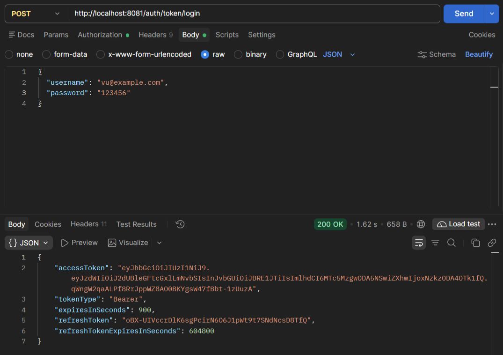
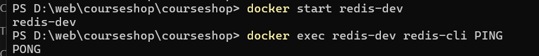
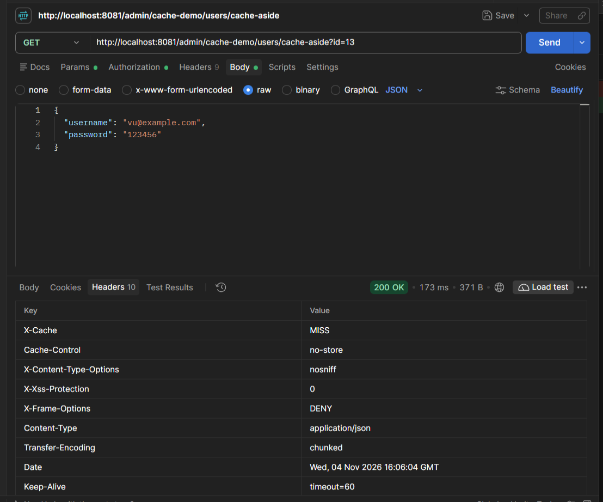
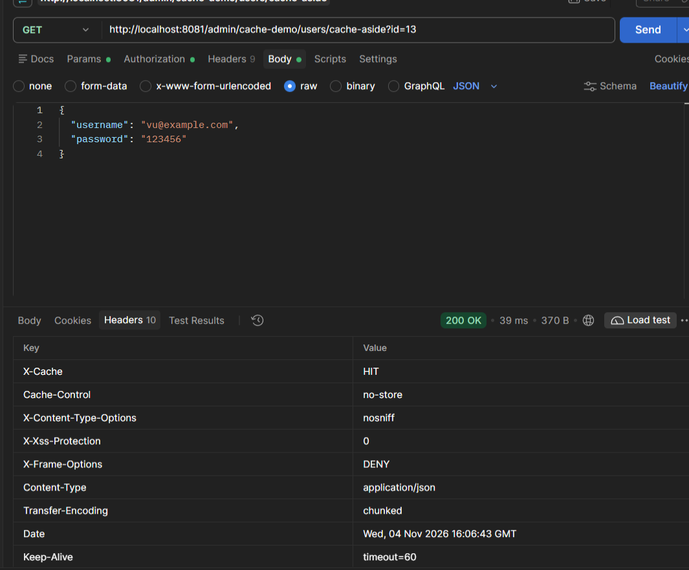
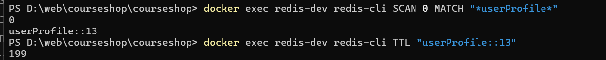

# Báo Cáo Chuyên Đề Tuần 5: Caching & Redis

---

## 1. Tìm Hiểu Caching

### 1.1. Caching là gì? Tại sao cần Caching?
* **Khái niệm**: Caching (bộ nhớ đệm) là kỹ thuật lưu trữ tạm thời dữ liệu thường truy nhập hoặc các kết quả tính toán đắt đỏ ở một tầng lưu trữ có tốc độ truy xuất cực nhanh (thường là RAM). Mục đích nhằm phục vụ cho các yêu cầu đọc dữ liệu tiếp theo mà không cần phải gọi lại tới nguồn lưu trữ gốc (như Database, Third-party API, hoặc Disk I/O).
* **Tại sao cần Caching?**
  1. **Giảm độ trễ (Lower Latency)**: Tốc độ đọc từ bộ nhớ RAM chỉ mất khoảng vài microsecond ($\mu s$) đến vài millisecond ($ms$), nhanh hơn từ 100 đến 1000 lần so với truy vấn đĩa cứng của Database.
  2. **Giảm tải cho Database (Offload DB)**: Giảm bớt các câu lệnh `SELECT` phức tạp (nhiều phép JOIN, Aggregate), giúp Database tập trung tài nguyên xử lý các tác vụ quan trọng khác hoặc ghi dữ liệu.
  3. **Tăng khả năng mở rộng (High Scalability)**: Giúp ứng dụng xử lý lưu lượng truy cập đột biến (Traffic Spikes) mà hệ thống cơ sở dữ liệu truyền thống không kham nổi.
  4. **Tối ưu chi phí (Cost Efficiency)**: Mở rộng hạ tầng RAM cho Caching thường rẻ và hiệu quả hơn việc scale nốt cho các cụm Database lớn.

### 1.2. Cache ở đâu? Application-level vs Distributed Cache

| Tiêu chí | Application-level Cache (Local Cache) | Distributed Cache (Cache phân tán) |
| :--- | :--- | :--- |
| **Vị trí** | Nằm trực tiếp trong bộ nhớ RAM của Process ứng dụng (ví dụ: `Map`, `Guava`, `Caffeine`). | Đặt trên một cụm máy chủ độc lập (ví dụ: **Redis**, **Memcached**). |
| **Tốc độ** | **Cực nhanh** (Không tốn latency truyền tải qua mạng Network). | **Nhanh** (Tốn $1 - 2ms$ cho chi phí truyền qua mạng). |
| **Khả năng chia sẻ** | **Không**. Mỗi instance ứng dụng có bộ đệm riêng biệt. | **Có**. Nhiều instance/microservice cùng truy cập một nguồn cache chung. |
| **Dung lượng** | Bị giới hạn bởi heap size của RAM ứng dụng. | Dễ dàng mở rộng theo chiều ngang (Cluster horizontal scaling). |
| **Tính bền vững (Persistence)** | Mất toàn bộ cache khi ứng dụng Restart hoặc Crash. | Hỗ trợ lưu trữ xuống ổ đĩa (RDB/AOF trong Redis) và hỗ trợ Replicas. |

### 1.3. Khi nào nên cache, khi nào KHÔNG nên cache?

#### NÊN Cache khi:
* Dữ liệu có tần suất **Đọc nhiều - Ghi ít** (Read-heavy, Write-rare) như: danh mục sản phẩm, bài viết blog, thông tin cấu hình hệ thống, thông tin cá nhân cơ bản (Profile).
* Kết quả của các truy vấn đắt đỏ (Complex SQL queries, phép tính toán thống kê nặng).
* Dữ liệu từ các dịch vụ bên thứ ba (Third-party APIs) bị giới hạn rate limit hoặc phản hồi chậm.
* Ứng dụng chấp nhận tính nhất quán dữ liệu theo thời gian (Eventual Consistency).

#### KHÔNG NÊN Cache khi:
* Dữ liệu biến động liên tục với tần suất cao (ví dụ: giá chứng khoán real-time, chỉ số dòng tiền).
* Dữ liệu đòi hỏi tính nhất quán tuyệt đối tức thì (Strict Consistency) như: số dư tài khoản ngân hàng, giao dịch ví điện tử.
* Dữ liệu có tần suất đọc rất thấp (Read rare) -> Lưu trữ chỉ lãng phí bộ nhớ RAM.
* Dữ liệu nhạy cảm chưa được mã hóa an toàn.

---

## 2. Chiến Lược Caching (Caching Strategies)

### 2.1. Cache-Aside (Lazy Loading)
Đây là chiến lược phổ biến nhất trong các ứng dụng Web.

* **Luồng xử lý (Flow)**:
  1. Client gửi yêu cầu đọc dữ liệu.
  2. Application kiểm tra dữ liệu trong Cache:
     * **Cache Hit**: Trả dữ liệu trực tiếp từ Cache cho Client.
     * **Cache Miss**: Application thực hiện query từ Database.
  3. Khi nhận dữ liệu từ DB, Application ghi dữ liệu đó vào Cache (kèm TTL).
  4. Phản hồi dữ liệu cho Client.

```
[Client] ---> (1) Read ---> [App Node] ---> (2a) Hit ---> [Cache]
                                |
                           (2b) Miss
                                |
                                v
                           (3) Query DB ---> [Database]
                                |
                           (4) Set Cache -> [Cache]
```

* **Ưu điểm**:
  * Chỉ nạp những dữ liệu được yêu cầu vào Cache $\rightarrow$ Tối ưu bộ nhớ.
  * Khi Cache Server hỏng, hệ thống vẫn có thể fall-back về truy vấn trực tiếp DB.
* **Nhược điểm**:
  * Request đầu tiên (Cache Miss) sẽ bị trễ hơn thông thường.
  * Dễ gặp hiện tượng dữ liệu bị cũ (Stale Data) nếu DB thay đổi nhưng Cache chưa kịp xóa/cập nhật.

### 2.2. Write-Through
* **Luồng xử lý (Flow)**:
  1. Khi có yêu cầu ghi/cập nhật dữ liệu, Application thực hiện ghi đồng thời vào **Cache** và **Database**.
  2. Thao tác ghi chỉ thành công khi cả 2 nơi hoàn tất.

* **Ưu điểm**:
  * Dữ liệu trong Cache luôn được cập nhật mới nhất, nhất quán hoàn toàn với DB.
  * Các truy vấn đọc sau đó 100% là Cache Hit.
* **Nhược điểm**:
  * Tăng độ trễ cho tác vụ Write.
  * Lãng phí RAM nếu dữ liệu được ghi nhưng sau đó không ai đọc.

### 2.3. So sánh & Lựa chọn
* **Dùng Cache-Aside**: Phù hợp cho hầu hết các dịch vụ Web/REST API đọc dữ liệu thông thường.
* **Dùng Write-Through**: Phù hợp với các hệ thống cần đọc ngay lập tức dữ liệu vừa tạo với độ chính xác cao và số lượng ghi không quá dồn dập.

---

## 3. Redis Cơ Bản

### 3.1. Redis là gì?
**Redis** (Remote Dictionary Server) là một hệ quản trị dữ liệu lưu trữ trên bộ nhớ RAM (In-memory Data Structure Store) với mã nguồn mở. Redis thường được ứng dụng làm **Cache**, **Message Broker** (Pub/Sub, Streams), và **NoSQL Database**.

* **Đặc điểm**:
  * Xử lý **Single-threaded** (tránh Overhead lock/context-switch) nhưng đạt hiệu năng cao nhờ I/O Multiplexing.
  * Hỗ trợ cơ chế **Persistence** (RDB snapshots & AOF log file) giúp khôi phục dữ liệu khi restart.

### 3.2. Cấu trúc dữ liệu chính trong Redis
1. **String**: Cấu trúc cơ bản nhất (Text, số, chuỗi JSON, nhị phân). Giới hạn tối đa 512MB.
2. **Hash**: Tập hợp các cặp `field-value`. Rất thích hợp để lưu đối tượng (Object) như User Profile.
3. **List**: Danh sách liên kết chuỗi (Linked List). Thích hợp làm hàng đợi (Queue), timeline.
4. **Set**: Tập hợp các phần tử độc nhất (không trùng lặp), không có thứ tự.
5. **Sorted Set (ZSet)**: Giống Set nhưng mỗi phần tử đi kèm một điểm số (`score`). Tự động sắp xếp theo `score`. Thích hợp làm Bảng xếp hạng (Leaderboard), Rate Limiter.

### 3.3. Các lệnh cơ bản
```bash
# Gán giá trị
SET product:100 "Laptop Dell XPS"

# Lấy giá trị
GET product:100

# Xóa key
DEL product:100

# Đặt thời gian sống (TTL) 60 giây cho key
EXPIRE product:100 60

# Kiểm tra TTL còn lại (trả về số giây, -1 là vô hạn, -2 là không tồn tại)
TTL product:100

# SET nguyên tử kèm TTL (60s)
SETEX product:100 60 "Laptop Dell XPS"
```

### 3.4. Cài đặt Redis bằng Docker
Tạo file `docker-compose.yml`:
```yaml
version: '3.8'
services:
  redis:
    image: redis:7-alpine
    container_name: demo_redis
    ports:
      - "6379:6379"
    restart: always
```
Chạy lệnh khởi động:
```bash
docker compose up -d
```

---

## 4. Implement — Tích Hợp Redis Vào Project (Node.js & Express)

Xem code ạ!! Mục UserCacheService và UserCacheController

## 5. Kết Quả Demo & So Sánh Response Time

Thực hiện gọi API `GET http://localhost:3000/products/101` qua Curl hoặc Postman:

### Lần 1: Cache Miss 
- Đăng nhập lấy access token

- bật redis trong docker

- chạy lần 1: Miss

### Lần 2: Cache Hit
- chạy lần 2: Hit

- kiểm tra key và TTL trong redis



## 6. Các Vấn Đề Thường Gặp & Giải Pháp Tối Ưu

### 6.1. Thiết lập TTL (Time To Live) hợp lý
* **Vấn đề**: TTL quá dài dẫn đến dữ liệu bị cũ (Stale); TTL quá ngắn sẽ làm giảm hiệu quả của Cache.
* **Chiến lược đặt TTL**:
  * *Dữ liệu tĩnh/Cấu hình*: TTL từ 12h - 24h.
  * *Dữ liệu ít thay đổi (Thông tin User, Sản phẩm)*: TTL từ 15m - 60m.
  * *Dữ liệu biến đổi nhanh (Bảng xếp hạng, Tin tức hot)*: TTL từ 1m - 5m.

### 6.2. Cache Invalidation (Xóa/Cập nhật Cache)
* Khi dữ liệu dưới DB bị `UPDATE` hoặc `DELETE`, Cache sẽ chứa dữ liệu sai sót nếu không được xử lý.
* **Giải pháp**:
  * **Proactive Eviction**: Trong các hàm Update/Delete ở Backend, chủ động gọi lệnh xóa Key trong Redis:
    ```javascript
    await redisClient.del(`product:${productId}`);
    ```

### 6.3. Cache Avalanche (Thảm họa Cache)
* **Vấn đề**: Hàng loạt Key hết hạn (TTL) cùng một thời điểm, hoặc Server Redis bị sập. Hàng ngàn request dồn dập rơi xuống DB cùng lúc khiến DB bị quá tải và sập theo.
* **Giải pháp**:
  1. **Random TTL (Jitter)**: Cộng thêm một khoảng thời gian ngẫu nhiên vào TTL khi ghi cache:
     $$\text{TTL} = \text{Base\_TTL} + \text{Random}(0, 300\text{s})$$
  2. **Dùng cụm HA (High Availability)**: Triển khai Redis Sentinel hoặc Redis Cluster.

### 6.4. Cache Penetration (Thủng Cache)
* **Vấn đề**: Request liên tục truy nhập các Key **không tồn tại** trong cả Cache lẫn DB (ví dụ: `ID = -9999`). Request luôn bị miss cache và đâm thẳng xuống DB, nguy cơ bị tấn công DDOS.
* **Giải pháp**:
  1. **Cache Null Values**: Khi DB trả về `null`, vẫn ghi giá trị rỗng đó vào Redis với TTL ngắn (ví dụ: 2-5 phút).
  2. **Bloom Filter**: Sử dụng cấu trúc dữ liệu Bloom Filter đứng trước Cache để lọc nhanh các ID chắc chắn không tồn tại.

